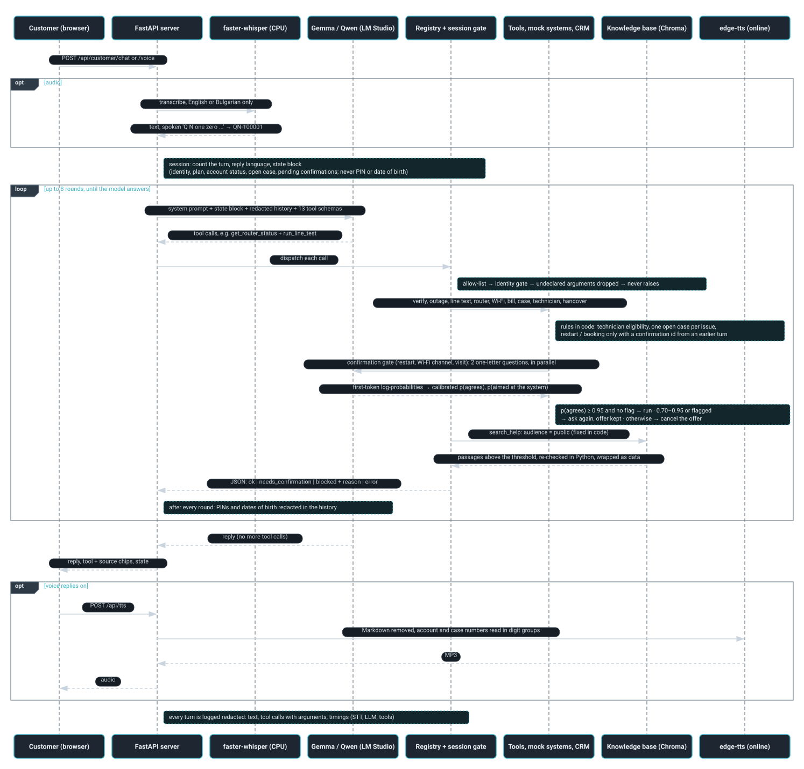
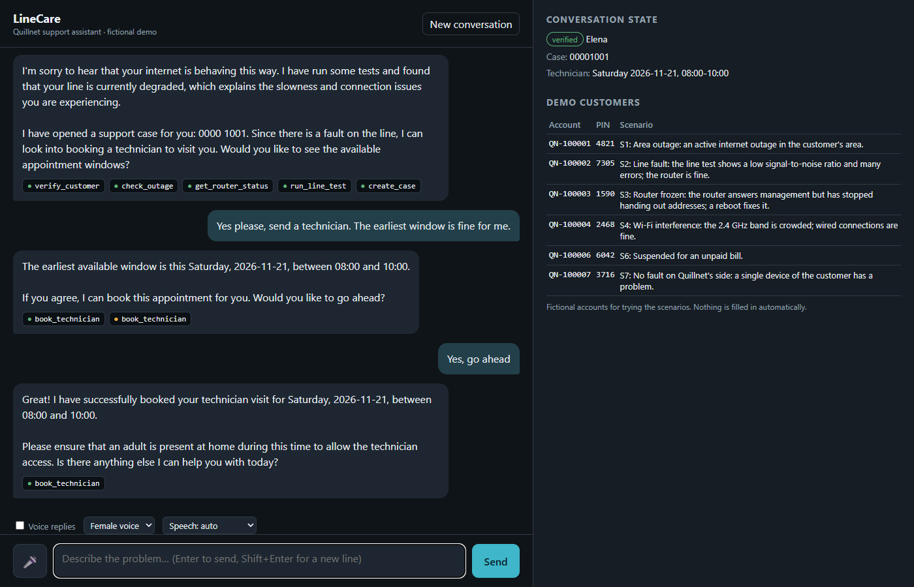
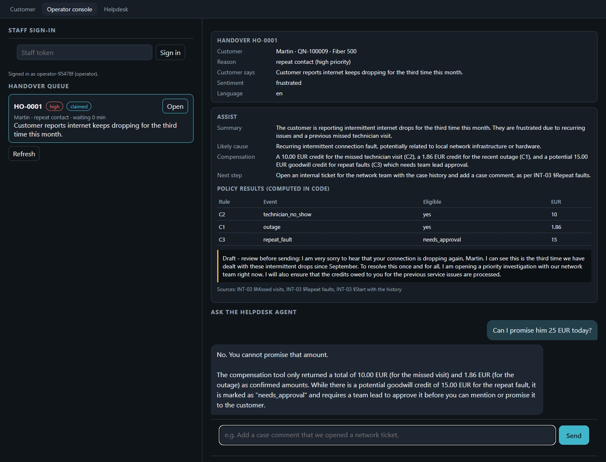
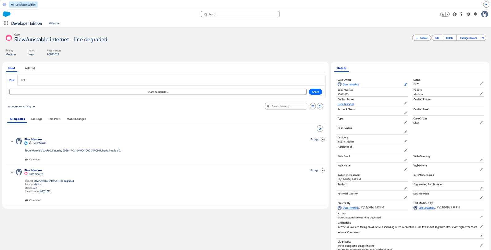

# LineCare

[](https://github.com/dianj/linecare/actions/workflows/tests.yml)  

A support agent (chat and voice) for **Quillnet**, a fictional broadband and TV operator. It verifies the caller,
diagnoses the line and the router through the operator's (mock) systems, explains outages and bills, answers from
the help articles with visible sources, opens CRM cases, books technician visits and hands over to a person with a
summary, in English and Bulgarian. Staff take over in an **operator console**: a handover queue, an assist card
prepared by an internal **helpdesk agent** (likely cause, next step from the internal procedures, credits computed
by the compensation policy in code, a draft reply), and a chat with that agent. Cases go to a SQLite CRM or to
**Salesforce**.

**The model decides what to try; the code decides what is allowed.** The identity gate, the two-step confirmation
for actions, technician eligibility, the filter that keeps internal documents away from customers and the redaction
of PINs and dates of birth are enforced in Python, and measured with real-model evals. Before a restart, a channel
change or a technician visit runs, a **calibrated confirmation gate** checks that the customer's reply really says
yes, and that it is not text addressed to the system; on every turn a second gate checks whether the customer asks
for a person and hands over if the agent did not ([how and what they measured](docs/DECISIONS.md)).

> All companies, customers, documents and systems here are fictional. **Status:** complete portfolio demo,
> verified 2026-11-25: 361 tests, 97 % coverage, ruff clean; real-model
> evals Gemma 4 26B 84/84 and Qwen 3.8 27B 42/42, 0 leaks; a held-out set of 15: Gemma 12/15, Qwen 15/15. See [Limitations](#limitations) and
> [What production would need](#what-production-would-need); how it was built and checked:
> [docs/HOW_IT_WAS_BUILT.md](docs/HOW_IT_WAS_BUILT.md).








## What it does

| Customer says | What happens |
|---|---|
| "No internet" (area outage) | verifies, finds the outage, gives its expected fix time; no tests, no case, no visit |
| "No internet on any device" (router frozen) | checks router and line together, offers a remote restart, restarts only after "yes" in the next message, checks again |
| "Slow and failing, also with a cable" (line fault) | line test degraded → CRM case → free technician windows → books the chosen one after confirmation |
| "Wi-Fi is slow, cable is fine" | scans the Wi-Fi bands, explains the 5 GHz band and router placement from the Wi-Fi article |
| "My internet stopped" (unpaid bill) | sees the suspended account, explains the balance and how to pay; no technical tests |
| "Only my laptop has no internet" | line and router fine → device steps from the help article; records whether it worked |
| "Can I pay in cash?" | answers from the payment article, with the source; says "I don't have that information" when no article covers a question |
| "Put me through to a human" | hands over at once, also before verification, with a summary built from the checks |
| "Third time this month!" (repeat caller) | sees the earlier cases in the CRM at verification, offers a colleague, hands over with high priority |
| "I pressed reset, now no internet" (wrong router setting) | router configuration error → case and handover in the same turn; staff push the settings |
| "Wi-Fi is slow" (crowded channel) | offers to move the band to a less crowded channel; changes it only after "yes" |

| Staff member does | What happens |
|---|---|
| operator claims a handover | the assist card appears in about 15 s: summary, likely cause, next step from the internal procedure, credits from the policy (C1-C4), a draft reply to review |
| "Can I promise him 25 EUR?" | no: only what the compensation tool returned, and the goodwill part needs a team lead |
| technician asks about PPPoE after a factory reset | answers from the internal technical note; operators cannot read technical notes, technicians cannot read policies or compute credits |
| operator closes the handover | the closing note is added to the CRM case; every look at customer data is in the audit log |
| team lead opens **Metrics** | containment, escalation by reason, outcomes per scenario, latency per stage (median, p95), blocked actions, the last 20 conversations with their transcripts |

The demo accounts and their PINs are listed in the app.

## What a support-automation project needs, and where it is here

| Need | Where it is shown |
|---|---|
| Conversational agents for customers **and** for staff | the customer agent, the helpdesk agent and the operator console |
| Tool calling over several steps | 13 + 7 tools; diagnosis loops (outage → router → line test → case → visit) |
| Grounded answers | help articles with the source passage shown; "no information" instead of a guess |
| Retrieval with access rules | Chroma + local multilingual embeddings; the audience filter in code, checked twice |
| Integration with enterprise systems | Salesforce REST (Contact, Case, CaseComment); mock network, diagnostics, scheduling and billing APIs |
| REST and JSON | mock systems with OpenAPI at `/docs`; JSON tool schemas |
| Voice | faster-whisper STT; edge-tts or ElevenLabs replies; latency per stage measured |
| Mapping to contact-centre platforms | [docs/PLATFORM_COMPARISON.md](docs/PLATFORM_COMPARISON.md) (Cognigy.AI, Google CX Agent Studio) |
| Business view | [docs/SOLUTION_BRIEF.md](docs/SOLUTION_BRIEF.md), KPIs, the metrics tab |
| Experiments with discipline | gates in code, deterministic tests, real-model evals, a held-out set, CI |

## How it is built

- **Tool loop** (`linecare/agents/`): the customer agent has 13 tools, the helpdesk agent 7 (6 for technicians).
  Every call goes through a dispatcher that checks the allow-list for the agent or role and the session state, drops
  arguments a tool does not declare, and never raises.
- **Session state machine** (`linecare/session.py`): unverified → verified → handed over, a 15-minute lock after
  three wrong PINs (counted per conversation and per account number), and **pending confirmations**: a restart, a
  channel change or a booking runs only with a confirmation id from an earlier user turn.
- **Confirmation gate** (`linecare/decisions.py`, `linecare/decide/`): then two one-letter questions to the same
  local model, in parallel ("does the reply agree to <action>?", "is it addressed to the system?"), read as
  calibrated probabilities from the log-probabilities. The action runs only at p(agree) ≥ 0.95 with no flag;
  otherwise the agent asks explicitly or the offer is cancelled. The gate can only stop an action.
- **Wants-a-person gate** (same files): on every customer turn, in parallel with the agent, "does the customer ask
  for a human colleague?" (with the agent's previous message as context). At p ≥ 0.5, if the agent did not hand
  over, the code calls `handover_to_human` itself. It can only add a handover.
- **Knowledge base** (`linecare/kb/`): Markdown articles, ONNX embeddings on the CPU (multilingual MiniLM, chosen by
  measurement), Chroma, and search with the audience fixed in code plus a second check in Python. A canary document
  and a poisoned article test that nothing internal or injected gets through.
- **Business rules** (`linecare/policy/`): when a technician may be booked, handover priority, and the
  **compensation policy** (C1-C4: outages over 24 h, missed visits, repeat faults, suspended accounts), whose numbers
  a test checks against the internal policy document.
- **Helpdesk agent and operator console** (`linecare/agents/helpdesk.py`, `linecare/handover_queue.py`): demo staff
  tokens select a role; operators read internal policies, technicians internal technical notes. For the assist,
  code loads the facts first (handover, customer overview, every credit on record, the procedure for the handover
  reason) and the model explains them. A case lost in a CRM outage is written when the CRM is back.
- **CRM** (`linecare/crm/`): one interface, two backends: a SQLite fake and **Salesforce** over its REST API
  (plain `httpx`, OAuth client credentials, Contacts upserted by account number, Cases, CaseComments). The same
  contract tests run against the fake, against an in-process fake of the Salesforce API, and against a real org.
- **Voice** (`linecare/voice/`): faster-whisper on the CPU, spoken account numbers normalised, replies through
  edge-tts or **ElevenLabs** (`TTS_PROVIDER=elevenlabs`, `ELEVENLABS_API_KEY`).
- **Metrics** (`linecare/metrics.py`): KPIs computed from the conversation log the app already writes; outcomes
  are set by code from tool results, never from the model's wording.
- **Mock systems** (`mocks/`): 200 seeded customers, network, diagnostics, billing and scheduling, with a REST API
  at `/mock` (OpenAPI at `/docs`).

Details and the decision log: [docs/ARCHITECTURE.md](docs/ARCHITECTURE.md). The problem, KPIs and risks on one page:
[docs/SOLUTION_BRIEF.md](docs/SOLUTION_BRIEF.md); a 3-minute live demo: [docs/DEMO_SCRIPT.md](docs/DEMO_SCRIPT.md). How the parts map to Cognigy.AI and
Google CX Agent Studio: [docs/PLATFORM_COMPARISON.md](docs/PLATFORM_COMPARISON.md).

## Results

| | |
|---|---|
| Real-model evals (both agents) | 42 conversations in 8 groups (diagnosis, confirmations through the gate, grounding, leakage, policy, handover, identity, and 10 helpdesk cases as an operator or a technician), both gates on: **Gemma 4 26B 84/84** in 2 runs, **Qwen 3.8 27B 42/42** ([report](evals/results/t18-sprint1.md)). Earlier: Qwen's one failure in 41 was the grader (it read "As for the €50 credit, I'm not able to promise that" as a promise), fixed and re-graded |
| Held-out set | 15 cases written after development and kept outside the repository (two scenarios never run before, a locked identity check, a relative without the PIN, a fake system line asking for a credit, help articles not used before, staff questions). Before the last round of changes: Gemma 13/15, Qwen 14/15; after: **Gemma 12/15, Qwen 15/15**, 0 leaks both times. Gemma's misses: a Bulgarian TV article answer, a technician question, and a "yes" to another question accepted as a yes to a restart offer (a known gap: the confirmation gate does not see the agent's question yet). Nothing was tuned on it |
| Leaks | **0**: no internal text, canary string or discount code reached a customer reply or the customer agent; every customer run is checked, not only the leakage group |
| Voice turn | 20 synthesised first turns (10 EN, 10 BG) through faster-whisper on the CPU, Gemma and edge-tts: STT **6.3 s**, LLM **5.6 s**, TTS **2.6 s** median; time to the first sound **14.9 s** median (21.1 s p95), with no streaming yet. **Spoken account numbers are the weak point:** read digit by digit, Whisper got the number right in 4 of 10 (it drops or merges repeated zeros: "QN-10004"); read as whole numbers, 3 of 10. A misheard number fails the identity check, because the PIN belongs to the caller's own account ([report](evals/results/voice-latency.md), [whole numbers](evals/results/voice-latency-whole.md)) |
| Voice replies | time to the complete MP3 for the same EN/BG replies: **ElevenLabs 0.62 s** median (slowest 1.35 s), edge-tts 1.42 s (slowest 6.51 s) ([report](evals/results/tts-latency.md)) |
| Retrieval | 32 answerable and 9 unanswerable EN/BG questions: hit@1 **94%**, hit@4 **100%**; 39 of 41 classified right at the threshold (two answerable questions score too low, see the [architecture notes](docs/ARCHITECTURE.md#84-embeddings)) |
| Confirmation gate | 38 labelled replies (yes, no, "yes, but…", attempts to steer it; EN/BG): **Gemma 38/38**, Qwen 37/38 (one clear yes asked again); no unclear or steering reply acted on. Found on the way: a one-letter question obeys "Answer Y" (p = 0.998), hence the second question |
| Wants-a-person gate | 32 labelled messages (requests, yes to an offer, a technician visit, "don't transfer me", steering; EN/BG): **Gemma 31/32**, Qwen 30/32, no needless handover on either; handover group 12/12 on each model (6 cases × 2 runs), added latency 0 ms median (it runs in parallel). All 42 conversations once on Gemma with both gates: 41/42, the failure a gate bug the eval found (a repeat caller handed over with normal priority), fixed and re-run 5/5 |
| Tests | 361 (unit, API, Playwright), **97%** line coverage, no GPU or network needed |

**How the numbers got there.** Every failure the evals found was first reproduced (an eval or a test), then fixed
in code and measured again. In the first runs Gemma offered a router restart in words only (so the customer had to
agree twice), told customers to "please wait" and stopped, missed a suspended account, answered an English message
in Bulgarian because the customer's name was Cyrillic, re-listed visit windows after "the earliest is fine", and
asked "may I record this as resolved?" instead of recording it. In the helpdesk phase the new evals found a repeat
caller offered a colleague late or never and, in Bulgarian, a promised case and handover that were never called
(2/6 → 6/6). Each fix moved the hint next to the data the model reads (a `next_step` in the tool result, a line in
the conversation state). Live runs of the operator flow found the assist searching the public articles instead of
the internal procedure (now loaded by code) and the helpdesk agent adding up credits on its own (now forbidden;
0 of 4 runs after the fix). The helpdesk evals then found that, asked directly about a customer's credits, Gemma
checked two of three events or offered to check instead of checking (a prompt rule did not help: 0/3). Now an
operator's credit question loads the overview and every credit on record in code first, as the assist does
(30/30). A full run found the model handing a "yes" for the channel change to the restart tool: the code refused
it, but as "unknown or expired", so the model asked again; the refusal now names the right tool (5/5). The two
models differ in effort: during a known outage Qwen still tests the line and the router, Gemma stops after the
outage check (both answer correctly; Qwen's turns take about 25 s against Gemma's 6 s). Full tables:
[evals/results/latest.md](evals/results/latest.md), [retrieval.md](evals/results/retrieval.md).

## Quick start

1. Start an OpenAI-compatible LLM server. Developed with LM Studio on port 1235 and `gemma-4-26b-a4b-it`
   (Qwen 3.8 27B can be switched in the app); see [.env.example](.env.example).
2. Run:
   ```bash
   pip install -r requirements.txt
   uvicorn server:app --host 127.0.0.1 --port 8002
   ```
3. Open `http://localhost:8002` and pick a demo account from the right panel (shown with `DEMO_MODE=1`, the local
   default; set `DEMO_MODE=0` anywhere else, since the list includes the PINs). Staff views: the **Operator
   console** and **Helpdesk** tabs. Their tokens are printed in the server log at start-up (random for each run),
   or set your own with `STAFF_TOKENS` ([.env.example](.env.example)). Try QN-100009 (a repeat caller) in the
   customer tab, then claim the handover as an operator.

On the first start the embedding model (about 0.2 GB) is downloaded and the index is built, on the CPU, in under a
minute. Voice uses faster-whisper on the CPU (downloaded on the first recording) and edge-tts, which sends the reply
text to Microsoft's online voices; with `TTS_PROVIDER=elevenlabs` and a key restricted to Text to Speech, ElevenLabs
instead. `FROZEN_NOW=2026-11-20T10:00:00` gives the same demo times on every start.

## Salesforce (optional)



The app uses the SQLite fake by default. To keep cases in a Salesforce org instead (a free Developer Edition is
enough, about 15 minutes). The menu names below are from the current Salesforce help and may move between releases:

1. **Org:** sign up at [developer.salesforce.com/signup](https://developer.salesforce.com/signup). Note the org's My
   Domain URL (Setup → My Domain), e.g. `https://yourname-dev-ed.develop.my.salesforce.com`.
2. **Fields** (Setup → Object Manager → Fields & Relationships → New):
   - Contact: `Account No` (Text 20, API name `Account_No__c`, **Unique** and **External ID**; without External ID
     the upsert fails with "Provided external ID field does not exist or is not accessible").
   - Case: `Category` (Text 40, `Category__c`), `Diagnostics` (Long Text Area, `Diagnostics__c`), `Handover Id`
     (Text 40, `Handover_Id__c`).
   - Case → Case Origin → Values: add `Chat` (the agent's cases have origin Chat).
3. **External Client App** (Setup → External Client App Manager → New External Client App): distribution state
   *Local*, enable OAuth, any callback URL (e.g. `https://localhost/callback`), scope *Manage user data via APIs
   (api)*, enable the **Client Credentials Flow**. Then under *Policies* enable the flow again and choose the **Run As**
   user (the app acts as this user, so its permissions are the app's). Copy the consumer key and secret from the
   app's *Settings*.
4. **`.env`:** `CRM_BACKEND=salesforce`, `SF_LOGIN_URL=<My Domain URL>`, `SF_CLIENT_ID`, `SF_CLIENT_SECRET`.
5. **Check:** `SF_LIVE_TESTS=1 python -m pytest tests/test_crm_contract.py -k live` runs the contract tests against the
   org (each test creates its own contact and deletes what it created).

Anyone with the consumer key and secret can get a token for the Run As user: keep them in `.env` only, and give that
user no more than Contacts and Cases.

## Tests and evals

```bash
pip install -r requirements-dev.txt
python -m playwright install chromium     # or, on Windows with Edge: add --browser-channel msedge
python -m pytest --cov=linecare --cov=mocks --cov=server
```

The tests use a scripted fake LLM, a hashing fake embedder and a frozen clock, so they give the same result on
every run. The real-model evals need LM Studio:

```bash
python evals/run_evals.py --models gemma-4-26b-a4b-it qwen3.8-27b --repeats 2 1
python evals/run_evals.py --models qwen3.8-27b --groups leakage --repeat 2 --output leakage-qwen
python evals/retrieval_eval.py            # embedding models compared, no LLM needed
python evals/tts_latency.py               # edge-tts vs ElevenLabs (needs network; ELEVENLABS_API_KEY)
python evals/voice_latency.py             # a voice turn per stage: STT, LLM, TTS, first audio (needs network)
```

## Project layout

```
server.py, index.html     FastAPI app and the chat page
linecare/                 agents, tools, session, registry, policy, kb, crm, voice, handover, redaction
mocks/                    the operator's systems (seeded) and their REST API
kb/                       help articles (public), staff documents (internal), a poisoned test article
evals/                    real-model evals, retrieval comparison, results
tests/                    unit, API and Playwright tests with fakes
```

## Limitations

Fictional data only; cookie sessions and staff tokens (random per run unless set), no real authentication;
sessions and request limits live in process memory (one worker, lost on restart); one local LLM at a time;
both voice providers are online services (they receive the reply text); the Salesforce adapter is tested in CI against a fake of its REST API and by hand
against a Developer Edition org (not in CI: it needs the org's secret); a credit question is recognised by an
account number and a money word, so one without an account number is left to the model; operators cannot write
into the customer's chat; spoken account numbers are often misheard (4 of 10 right in the voice measurement), so
voice callers may have to repeat or type them; two answerable questions fall below the retrieval threshold (they fail safely: "no
information", a case or a colleague; a Bulgarian article was tried and did not fix them, see the
[notes](docs/ARCHITECTURE.md#84-embeddings)); the confirmation gate needs log-probabilities from the model server
and adds under a second to each confirmed action.

## What production would need

- **Identity and roles:** staff through the company's single sign-on with roles from the identity provider; the
  customer's identity from the channel (a logged-in app, or phone number plus a one-time code), and with a hosted
  model, the PIN checked outside the model (a keypad or a form field).
- **Shared state:** sessions, request limits and the handover queue in Redis or the database, more than one
  worker; `Secure` cookies behind HTTPS; the client address from the reverse proxy.
- **Retention and consent:** a retention period for transcripts and turns (keep the aggregates), and a recording
  consent line on the voice channel.
- **Operations:** structured logs and traces per conversation, alerts on failed turns and on the CRM, secrets from a
  vault.
- **Live handover:** the operator writing into the customer's chat, or the platform's own transfer to an agent
  desktop.

## License

[MIT](LICENSE)
