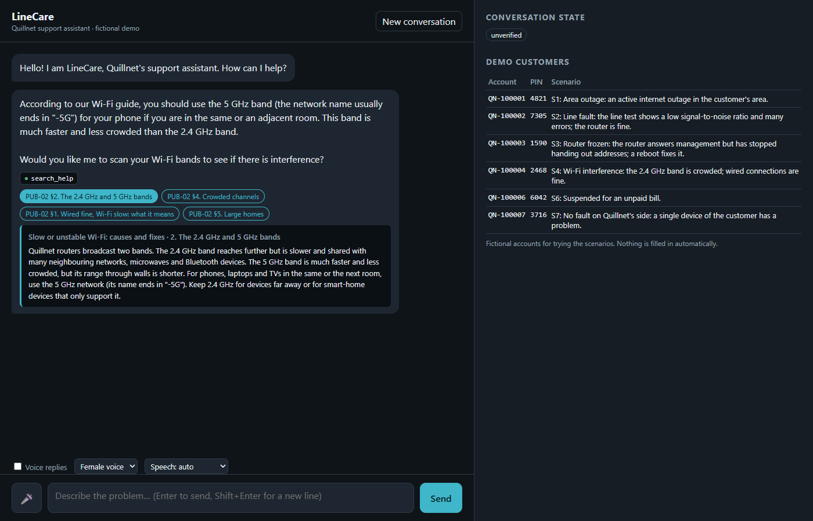

# LineCare

[](https://github.com/dianj/linecare/actions/workflows/tests.yml)  

A support agent (chat and voice) for **Quillnet**, a fictional broadband and TV operator. It verifies the caller,
diagnoses the line and the router through the operator's (mock) systems, explains outages and bills, answers from
the help articles with visible sources, opens CRM cases, books technician visits and hands over to a person with a
summary, in English and Bulgarian.

**The model decides what to try; the code decides what is allowed.** The identity gate, the two-step confirmation
for actions, technician eligibility, the filter that keeps internal documents away from customers and the redaction
of PINs and dates of birth are enforced in Python, and measured with real-model evals.

> All companies, customers, documents and systems here are fictional. Work in progress: the customer side is
> built; a Salesforce adapter is in place; an internal helpdesk agent and an operator console are next
> ([roadmap](docs/ARCHITECTURE.md#15-roadmap-and-limitations)).




## What it does

| Customer says | What happens |
|---|---|
| "No internet" (area outage) | verifies, finds the outage, gives its expected fix time; no tests, no case, no visit |
| "No internet on any device" (router frozen) | checks router and line together, offers a remote restart, restarts only after "yes" in the next message, checks again |
| "Slow and failing, also with a cable" (line fault) | line test degraded → CRM case → free technician windows → books the chosen one after confirmation |
| "Wi-Fi is slow, cable is fine" | scans the Wi-Fi bands, explains the 5 GHz band and router placement from the Wi-Fi article |
| "My internet stopped" (unpaid bill) | sees the suspended account, explains the balance and how to pay; no technical tests |
| "Only my laptop has no internet" | line and router fine → device steps from the help article; records whether it worked |
| "Can I pay in cash?" | answers from the payment article, with the source; says "I don't have that information" when no article covers a question |
| "Put me through to a human" | hands over at once, also before verification, with a summary built from the checks |

The demo accounts and their PINs are listed in the app.

## How it is built

- **Tool loop** (`linecare/agents/`): the model calls 12 tools through a dispatcher that checks the allow-list and
  the session state, drops arguments a tool does not declare, and never raises.
- **Session state machine** (`linecare/session.py`): unverified → verified → handed over, a 15-minute lock after
  three wrong PINs, and **pending confirmations**: a restart or a booking runs only with a confirmation id from an
  earlier user turn.
- **Knowledge base** (`linecare/kb/`): Markdown articles, ONNX embeddings on the CPU (multilingual MiniLM, chosen by
  measurement), Chroma, and search with the audience fixed in code plus a second check in Python. A canary document
  and a poisoned article test that nothing internal or injected gets through.
- **Business rules** (`linecare/policy/`): when a technician may be booked, handover priority.
- **CRM** (`linecare/crm/`): one interface, two backends: a SQLite fake and **Salesforce** over its REST API
  (plain `httpx`, OAuth client credentials, Contacts upserted by account number, Cases, CaseComments). The same
  contract tests run against the fake, against an in-process fake of the Salesforce API, and against a real org.
- **Voice** (`linecare/voice/`): faster-whisper on the CPU, spoken account numbers normalised, edge-tts replies.
- **Mock systems** (`mocks/`): 200 seeded customers, network, diagnostics, billing and scheduling, with a REST API
  at `/mock` (OpenAPI at `/docs`).

Details and the decision log: [docs/ARCHITECTURE.md](docs/ARCHITECTURE.md).

## Results

| | |
|---|---|
| Real-model evals | 25 conversations in 7 groups: **Gemma 4 26B 49/50** (2 runs), **Qwen 3.8 27B 25/25**; leakage group on Qwen twice: 10/10 |
| Leaks | **0**: no internal text, canary string or discount code reached a reply or the model |
| Retrieval | hit@4 **100%** on 24 English and Bulgarian questions; all 9 out-of-scope questions rejected |
| Tests | 212 (unit, API, Playwright), **97%** line coverage, no GPU or network needed |

**How the numbers got there.** Every failure the evals found was first reproduced (an eval or a test), then fixed
in code and measured again. In the first runs Gemma offered a router restart in words only (so the customer had to
agree twice), told customers to "please wait" and stopped, missed a suspended account, answered an English message
in Bulgarian because the customer's name was Cyrillic, re-listed visit windows after "the earliest is fine", and
asked "may I record this as resolved?" instead of recording it. Each fix moved the hint next to the data the model
reads (a `next_step` in the tool result, a line in the conversation state). Full tables:
[evals/results/latest.md](evals/results/latest.md), [retrieval.md](evals/results/retrieval.md).

## Quick start

1. Start an OpenAI-compatible LLM server. Developed with LM Studio on port 1235 and `gemma-4-26b-a4b-it`
   (Qwen 3.8 27B can be switched in the app); see [.env.example](.env.example).
2. Run:
   ```bash
   pip install -r requirements.txt
   uvicorn server:app --host 127.0.0.1 --port 8002
   ```
3. Open `http://localhost:8002` and pick a demo account from the right panel.

On the first start the embedding model (about 0.2 GB) is downloaded and the index is built, on the CPU, in under a
minute. Voice uses faster-whisper on the CPU (downloaded on the first recording) and edge-tts, which sends the reply
text to Microsoft's online voices. `FROZEN_NOW=2026-11-20T10:00:00` gives the same demo times on every start.

## Salesforce (optional)


The app uses the SQLite fake by default. To keep cases in a Salesforce org instead (a free Developer Edition is
enough, about 15 minutes). The menu names below are from the current Salesforce help and may move between releases:

1. **Org:** sign up at [developer.salesforce.com/signup](https://developer.salesforce.com/signup). Note the org's My
   Domain URL (Setup → My Domain), e.g. `https://yourname-dev-ed.develop.my.salesforce.com`.
2. **Fields** (Setup → Object Manager → Fields & Relationships → New):
   - Contact: `Account No` (Text 20, API name `Account_No__c`, **Unique** and **External ID**; without External ID
     the upsert fails with "Provided external ID field does not exist or is not accessible").
   - Case: `Category` (Text 40, `Category__c`), `Diagnostics` (Long Text Area, `Diagnostics__c`), `Handover Id`
     (Text 40, `Handover_Id__c`).
   - Case → Case Origin → Values: add `Chat` (the agent's cases have origin Chat).
3. **External Client App** (Setup → External Client App Manager → New External Client App): distribution state
   *Local*, enable OAuth, any callback URL (e.g. `https://localhost/callback`), scope *Manage user data via APIs
   (api)*, enable the **Client Credentials Flow**. Then under *Policies* enable the flow again and choose the **Run As**
   user (the app acts as this user, so its permissions are the app's). Copy the consumer key and secret from the
   app's *Settings*.
4. **`.env`:** `CRM_BACKEND=salesforce`, `SF_LOGIN_URL=<My Domain URL>`, `SF_CLIENT_ID`, `SF_CLIENT_SECRET`.
5. **Check:** `SF_LIVE_TESTS=1 python -m pytest tests/test_crm_contract.py -k live` runs the contract tests against the
   org (each test creates its own contact and deletes what it created).

Anyone with the consumer key and secret can get a token for the Run As user: keep them in `.env` only, and give that
user no more than Contacts and Cases.

## Tests and evals

```bash
pip install -r requirements-dev.txt
python -m playwright install chromium     # or, on Windows with Edge: add --browser-channel msedge
python -m pytest --cov=linecare --cov=mocks --cov=server
```

The tests use a scripted fake LLM, a hashing fake embedder and a frozen clock, so they give the same result on
every run. The real-model evals need LM Studio:

```bash
python evals/run_evals.py --models gemma-4-26b-a4b-it qwen3.8-27b --repeats 2 1
python evals/run_evals.py --models qwen3.8-27b --groups leakage --repeat 2 --output leakage-qwen
python evals/retrieval_eval.py            # embedding models compared, no LLM needed
```

## Project layout

```
server.py, index.html     FastAPI app and the chat page
linecare/                 agents, tools, session, registry, policy, kb, crm, voice, handover, redaction
mocks/                    the operator's systems (seeded) and their REST API
kb/                       help articles (public), staff documents (internal), a poisoned test article
evals/                    real-model evals, retrieval comparison, results
tests/                    unit, API and Playwright tests with fakes
```

## Limitations

Fictional data only; cookie sessions without real authentication; one local LLM at a time; the identity lock is
per conversation; edge-tts is an online service; the Salesforce adapter is tested in CI against a fake of its REST API and by hand against a Developer Edition org
(not in CI: it needs the org's secret).

## License

[MIT](LICENSE)
