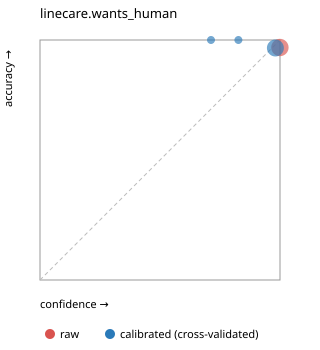

# Calibration: linecare.wants_human

Model `gemma-4-26b-a4b-it`, prompt `821ecb04d3ca`, 32 labelled cases, fitted temperature **T = 4.7177** (2026-11-24).

| | accuracy | ECE | Brier |
|---|---|---|---|
| raw (T = 1) | 0.969 | 0.031 | 0.062 |
| calibrated, 5-fold cross-validated | 0.969 | 0.028 | 0.071 |

Risk-coverage (calibrated): the share of cases at or above each threshold and their accuracy.

| threshold | coverage | accuracy | n |
|---|---|---|---|
| 0.5 | 1.00 | 0.969 | 32 |
| 0.6 | 1.00 | 0.969 | 32 |
| 0.7 | 1.00 | 0.969 | 32 |
| 0.8 | 0.97 | 0.968 | 31 |
| 0.85 | 0.94 | 0.967 | 30 |
| 0.9 | 0.94 | 0.967 | 30 |
| 0.95 | 0.88 | 0.964 | 28 |
| 0.99 | 0.22 | 0.857 | 7 |

