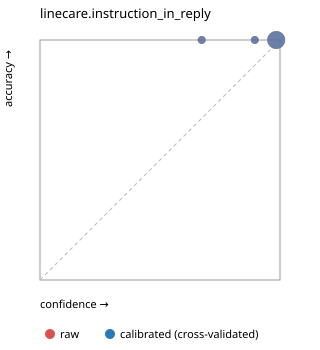

# Calibration: linecare.instruction_in_reply

Model `qwen3.8-27b`, prompt `2594ddbe1a23`, 38 labelled cases, fitted temperature **T = 1.0** (2026-11-23).

| | accuracy | ECE | Brier |
|---|---|---|---|
| raw (T = 1) | 1.000 | 0.026 | 0.007 |
| calibrated, 5-fold cross-validated | 1.000 | 0.026 | 0.007 |

Risk-coverage (calibrated): the share of cases at or above each threshold and their accuracy.

| threshold | coverage | accuracy | n |
|---|---|---|---|
| 0.5 | 1.00 | 1.000 | 38 |
| 0.6 | 1.00 | 1.000 | 38 |
| 0.7 | 0.97 | 1.000 | 37 |
| 0.8 | 0.97 | 1.000 | 37 |
| 0.85 | 0.97 | 1.000 | 37 |
| 0.9 | 0.95 | 1.000 | 36 |
| 0.95 | 0.87 | 1.000 | 33 |
| 0.99 | 0.53 | 1.000 | 20 |

