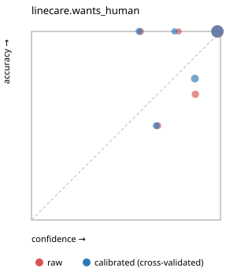

# Calibration: linecare.wants_human

Model `qwen3.8-27b`, prompt `821ecb04d3ca`, 32 labelled cases, fitted temperature **T = 1.0** (2026-11-24).

| | accuracy | ECE | Brier |
|---|---|---|---|
| raw (T = 1) | 0.938 | 0.075 | 0.111 |
| calibrated, 5-fold cross-validated | 0.938 | 0.071 | 0.114 |

Risk-coverage (calibrated): the share of cases at or above each threshold and their accuracy.

| threshold | coverage | accuracy | n |
|---|---|---|---|
| 0.5 | 1.00 | 0.938 | 32 |
| 0.6 | 0.94 | 0.933 | 30 |
| 0.7 | 0.88 | 0.964 | 28 |
| 0.8 | 0.84 | 0.963 | 27 |
| 0.85 | 0.78 | 0.960 | 25 |
| 0.9 | 0.72 | 1.000 | 23 |
| 0.95 | 0.62 | 1.000 | 20 |
| 0.99 | 0.47 | 1.000 | 15 |

